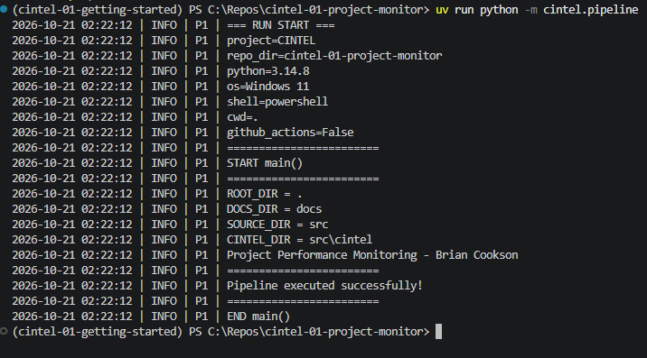

# Project Performance Monitoring — Continuous Intelligence

**Author:** Brian Cookson  
**Date:** 2026-10  
**Course:** Continuous Intelligence — Northwest Missouri State University

This project establishes a professional Python development environment and demonstrates how a Python pipeline can be configured, executed, and verified. It provides a foundation for a future project performance monitoring application focused on response times and operational efficiency.

## Data

No external dataset is required for the current version of this project.

The application generates execution information through Python logging, including details about the development environment and project directories.

Each log entry represents an execution event or informational message, rather than an individual project performance record.

No actual project performance data is currently collected, processed, or analyzed.

## Techniques Applied

This project demonstrates several professional Python development tools and techniques:

- **Python:** Executes the project's application logic.
- **uv:** Manages Python versions, virtual environments, and project dependencies.
- **Git and GitHub:** Track changes and maintain project history.
- **Visual Studio Code:** Provides the development environment for writing, editing, and executing code.
- **Structured logging:** Records execution information and project details.
- **Ruff:** Supports Python code formatting and linting.
- **ty:** Provides static type checking.
- **pytest:** Supports automated Python testing.
- **prek:** Manages Git hooks and automated quality checks.
- **Zensical and GitHub Pages:** Support the creation and publication of project documentation.

These tools establish a structured and reproducible workflow for developing, testing, and maintaining Python applications.

## Custom Modifications

This project was created using Dr. Denise Case's `cintel-01-getting-started` GitHub template.

The following customizations were completed:

1. Created a new public GitHub repository named `cintel-01-project-monitor`.
2. Customized the `README.md` file to describe a potential project performance monitoring application.
3. Updated the Python source files to include my name and the date.
4. Modified the logging output to display a personalized project message.
5. Configured the Python development environment and installed project dependencies.
6. Installed, updated, and executed automated Git hook checks.

The personalized logging message is:

```text
Project Performance Monitoring - Brian Cookson
```

These changes establish ownership of the project while preserving the original Python pipeline structure.

## Methods and Settings

The project uses the following development configuration:

| Component | Configuration |
|---|---|
| Operating System | Windows 11 |
| Python Version | 3.14.8 |
| Environment Manager | uv |
| Virtual Environment | `.venv` |
| Runtime Dependency | `datafun-toolkit` |
| Python Package | `cintel` |
| Source File | `src/cintel/pipeline.py` |
| Repository | `cintel-01-project-monitor` |

The Python application is executed from the project root using:

```powershell
uv run python -m cintel.pipeline
```

The pipeline uses the `datafun-toolkit` package to provide logging functionality.

Logging records information about the execution environment, project directories, and application activity.

No statistical thresholds, rolling windows, anomaly detection algorithms, or analytical models have been implemented in this introductory version.

## Verification

Several checks were performed to confirm that the development environment and Python application were functioning correctly.

### Development Environment

- Verified the installation of Git and Visual Studio Code.
- Updated uv to version 0.13.4.
- Installed and verified Python 3.14.8.
- Created an isolated Python virtual environment using `uv sync`.
- Successfully resolved and installed 35 Python packages.
- Completed a dependency audit with no known vulnerabilities reported among the audited packages.

### Code Quality

Git hooks were installed and executed using prek.

```powershell
uvx prek run --all-files
```

The applicable checks passed, including:

- Trailing whitespace validation.
- End-of-file newline verification.
- Line ending normalization.
- TOML and YAML syntax validation.
- Large binary file prevention.
- Merge conflict detection.
- Filename case conflict detection.
- Ruff formatting and linting.

### Pipeline Execution

The application was executed using:

```powershell
uv run python -m cintel.pipeline
```

The terminal displayed the following confirmation:

```text
Pipeline executed successfully!
```

The execution completed without an error.

## Results

The Python pipeline executed successfully and generated informational logging output.

The execution identified the project's operating system, Python version, repository directory, and relevant source and documentation directories.

The output also included the customized project message.

### Execution Evidence



*Figure 1. Successful execution of the customized Python pipeline in Visual Studio Code.*

### Confirmed Results

| Measurement | Observed Result |
|---|---|
| Python Version | 3.14.8 |
| Operating System | Windows 11 |
| Repository Directory | `cintel-01-project-monitor` |
| Source Directory | `src` |
| Documentation Directory | `docs` |
| Application Message | Project Performance Monitoring - Brian Cookson |
| Execution Status | Successful |

These results demonstrate that the project can execute its introductory Python pipeline within the configured development environment.

## Observations

The terminal output provides the following observations:

1. The application executed using Python 3.14.8.
2. The operating system was identified as Windows 11.
3. The repository and project directories were identified correctly.
4. The customized project message appeared in the output.
5. The program displayed the expected success message.
6. The pipeline completed without a reported execution error.

The output contains environment information and logging messages rather than project performance measurements.

## Interpretation and Insights

The successful execution demonstrates that the development environment and Python project configuration are functioning correctly.

The project also illustrates the importance of organizing Python applications into reusable modules and maintaining execution records through logging.

In professional analytics work, these practices can improve reproducibility, troubleshooting, and maintenance.

The current project establishes a technical foundation that could eventually support automated project performance monitoring.

However, additional development would be required before the application could collect data, identify trends, or support operational decisions.

## Limitations

The project currently serves as an introductory Python development and environment verification application.

Its limitations include:

- No real-world project performance dataset.
- No automated collection of incoming operational data.
- No response-time calculations.
- No statistical analysis or anomaly detection.
- No continuous monitoring functionality.
- No dashboard or analytical reporting interface.

The successful execution verifies the introductory pipeline but does not demonstrate a completed continuous intelligence monitoring system.

## Next Steps

Future development could expand the project into a project performance monitoring application.

Potential enhancements include:

1. **Data Collection:** Introduce a sample dataset containing project requests, submission dates, completion dates, and response times.
2. **Performance Metrics:** Calculate average response times, completion rates, and outstanding requests.
3. **Threshold Monitoring:** Identify requests that exceed predefined response-time limits.
4. **Anomaly Detection:** Detect unusual changes or delays in project performance.
5. **Visualization:** Generate charts and reports that summarize project activity.
6. **Continuous Intelligence:** Eventually automate monitoring so that new information can be analyzed as it becomes available.

These enhancements would build upon the existing Python environment and introduce more advanced analytics functionality.

## Project Links

- [Custom GitHub Repository](https://github.com/bcookson85/cintel-01-project-monitor)
- [Original Example Repository](https://github.com/denisecase/cintel-01-getting-started)
- [Original Python Pipeline](https://github.com/denisecase/cintel-01-getting-started/blob/main/src/cintel/pipeline.py)
- [Professional Python Workflow Guide](https://denisecase.github.io/pro-analytics-02/)
